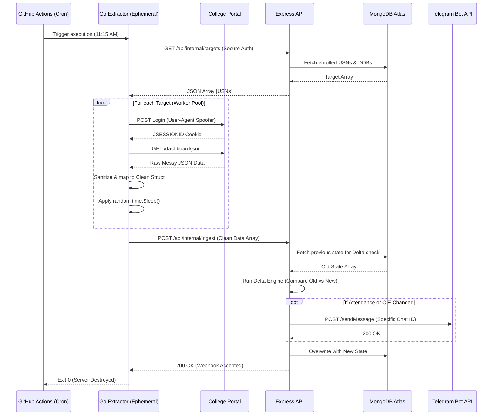
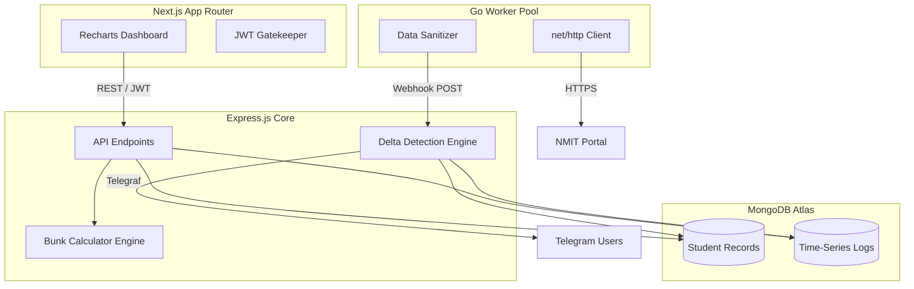

# 🦅 Vireo: System Architecture & Technical Blueprint

This document serves as the comprehensive technical specification and architectural blueprint for the Vireo platform. It details the design philosophies, technology choices, data flows, and infrastructure configurations required to maintain, scale, and contribute to the project.

---

## Table of Contents
1. [System Overview & Design Philosophy](#1-system-overview--design-philosophy)
2. [High-Level Architecture Diagrams](#2-high-level-architecture-diagrams)
3. [Frontend Architecture (Next.js)](#3-frontend-architecture-nextjs)
4. [Backend Architecture (Express.js)](#4-backend-architecture-expressjs)
5. [Data Extraction Engine (Go)](#5-data-extraction-engine-go)
6. [Database Design (MongoDB)](#6-database-design-mongodb)
7. [DevOps & Infrastructure (Docker & K8s)](#7-devops--infrastructure-docker--k8s)
8. [Continuous Integration (CI/CD)](#8-continuous-integration-cicd)

---

## 1. System Overview & Design Philosophy

Vireo is built to solve a highly specific problem: automating the extraction and analysis of student data from a reactive, legacy college portal without incurring expensive cloud computing costs. 

### Core Architectural Directives
*   **Decoupled Producer-Consumer Model:** Heavy network extraction is strictly isolated from business logic.
*   **Zero Compute Waste:** The system relies on ephemeral serverless runners (GitHub Actions) for heavy lifting, keeping the persistent API server memory footprint near zero.
*   **Frictionless Security:** Utilizing a single-password shared-secret model to eliminate user-management overhead while securing PII (Personally Identifiable Information).
*   **Stealth & Resilience:** Implementing anti-ban scraping techniques (rotating User-Agents, organic delays, raw HTTP requests) rather than brittle, RAM-heavy headless browsers (like Puppeteer/Playwright).

---

## 2. High-Level Architecture Diagrams

### 2.1 The 11:15 AM Execution Cycle (Data Flow)

The following diagram illustrates the complete data flow during a scheduled scraping event.

### 2.2 System Component Interaction

---

## 3. Frontend Architecture (Next.js)

The frontend is a lightweight, edge-cached presentation layer. It contains zero database drivers and relies entirely on the Express backend for data.

### 3.1 Technology Stack
*   **Framework:** Next.js 14 (App Router)
*   **Language:** TypeScript (Strict Mode)
*   **Styling:** Tailwind CSS
*   **Components:** shadcn/ui (Radix UI primitives)
*   **Data Visualization:** Recharts
*   **Data Fetching:** SWR or React Query (for automatic background revalidation)

### 3.2 Pages & Routing Structure
1.  **`/` (The Gatekeeper):** The landing page containing a single centered password input. No usernames.
2.  **`/dashboard`:** The main hub showing today's attendance summary, recent alerts, and upcoming holidays.
3.  **`/attendance`:** Detailed view of all subjects. Features interactive progress bars.
4.  **`/cie-tracker`:** A comparative, tabular view of internal marks across the peer group.
5.  **`/bunk-predictor`:** An interactive playground where users can simulate missing future classes to see how their percentage will react.

### 3.3 The Shared-Password Security Model
To maintain zero-friction access for trusted peers while keeping random internet traffic out, we use a shared-secret model.
*   **The Flow:** The user types the cohort password into the `/` route.
*   **The Request:** The frontend POSTs this to the Express `/api/auth/login` route.
*   **The Token:** Express verifies the password against an environment variable. If valid, Express returns a JWT inside an `HttpOnly`, `Secure`, `SameSite=Strict` cookie.
*   **The Protection:** Next.js Middleware (`middleware.ts`) checks for the existence of this cookie on every page transition. If the cookie is missing, the user is seamlessly redirected back to `/`. Because it is `HttpOnly`, malicious client-side scripts cannot steal the token.

### 3.4 Key Components & Visuals
*   **`SubjectRow.tsx`:** A reusable list item displaying the subject name, current percentage, and a color-coded badge (Green > 85%, Yellow 75-85%, Red < 75%).
*   **`BunkChart.tsx`:** A Recharts line graph in the `/bunk-predictor` route. The X-axis represents future classes, and the Y-axis represents the resulting percentage, showing a clear intersection line at the 85% threshold.
*   **`DeltaToast.tsx`:** An in-app notification component that alerts the user if the Express API reports a fresh update since their last page load.

---

## 4. Backend Architecture (Express.js)

The Express backend acts as the central nervous system. It holds 100% of the business logic, handles all database connections, and orchestrates the Telegram notifications.

### 4.1 Technology Stack
*   **Framework:** Node.js with Express v4
*   **Language:** TypeScript
*   **Database ORM:** Mongoose
*   **Bot Framework:** `telegraf` (for Telegram API interaction)
*   **Validation:** Zod (for validating incoming webhook payloads)

### 4.2 API Endpoint Architecture
The API is divided into two distinct security zones.

**Zone A: Public/Frontend Routes (JWT Protected)**
*   `POST /api/auth/login`: Validates the shared secret and issues the JWT cookie.
*   `GET /api/students/dashboard`: Returns aggregated attendance data for the frontend.
*   `GET /api/students/cie`: Returns the lab and theory marks array.
*   `GET /api/bunk-calc/:usn/:subject`: Returns the mathematical predictions for a specific subject.

**Zone B: Internal Webhook Routes (Secret Header Protected)**
*   `GET /api/internal/targets`: Returns the array of USNs and encrypted DOBs. Validates against `x-scraper-secret`.
*   `POST /api/internal/ingest`: The primary data intake valve. Accepts the sanitized JSON array from Go. Validates against `x-scraper-secret`.

### 4.3 Business Logic: The Delta Engine
When `POST /api/internal/ingest` is hit, the Delta Engine fires. It performs the following sequence:
1.  Pulls the incoming array into memory.
2.  Fetches the corresponding student's previous day's record from MongoDB.
3.  Compares `old.conducted` vs `new.conducted` and `old.attended` vs `new.attended`.
4.  If it detects an absence, it pushes a notification payload to an internal queue.
5.  Once the entire array is processed, the queue is flushed to the Telegram Bot API asynchronously to prevent blocking the HTTP response to Go.

### 4.4 Business Logic: Bunk Calculator Mathematics
The math logic is isolated in a utility class (`BunkEngine.ts`). It handles non-linear attendance calculations:
*   **Formula for Safe Bunks:** `Allowed Bunks = floor((Attended / TargetPercentage) - Conducted)`
*   **Formula for Recovery Classes:** If attendance is currently below 85%, how many back-to-back classes must be attended to reach 85%?
    *   `Required = ((Target * Conducted) - Attended) / (1 - Target)`

### 4.5 The Telegram Notification Engine
Using the `telegraf` package, the backend manages a Telegram bot.
*   **Registration:** A user messages the bot with `/start <their_usn>`. The bot extracts their unique Telegram `chat_id` and saves it to their MongoDB record.
*   **Live Alerts:** Fired by the Delta Engine (e.g., "🚨 You were marked absent in 22CS51").
*   **Cron Summaries:** At 6:00 PM IST, an internal `node-cron` job triggers a map-reduce function across the database, formats a comprehensive Markdown table of the day's stats, and sends it to all registered `chat_id`s.

---

## 5. Data Extraction Engine (Go)

The Go microservice acts as the Producer. It is designed to be highly concurrent, memory-efficient, and disposable. 

### 5.1 Why Go?
Node.js is excellent for routing and JSON manipulation, but managing headless browsers or thousands of raw HTTP connections can block the event loop or consume massive RAM. Go's native `net/http` package and lightweight Goroutines allow us to mimic organic network traffic efficiently.

### 5.2 Extraction Pipeline & Anti-Ban Mechanisms
1.  **Bounded Worker Pool:** The engine reads the target list and spins up exactly 3 worker Goroutines. This prevents the college firewall from detecting a sudden burst of 60 simultaneous connections.
2.  **Header Spoofing:** Each worker randomly selects a User-Agent from a predefined array of modern browser strings (Chrome, Firefox, Safari) and injects realistic `Accept-Language` and `Sec-Fetch-Dest` headers.
3.  **Cookie Management:** Utilizing Go's `net/http/cookiejar`, the worker automatically captures the `JSESSIONID` from the login POST request and attaches it to the subsequent GET requests for data.
4.  **Organic Delays:** A `time.Sleep` of 1.5 to 3 seconds is injected between each worker's iterations.
5.  **Sanitization:** The raw JSON from the portal is unmarshaled into a loose Go struct, then carefully mapped into a strict, validated struct before being marshaled back to JSON for the Express webhook. This guarantees Express never receives malformed data.
6.  **Mutex Locking:** Appending the cleaned student data to the master array is protected by a `sync.Mutex` to prevent data races across the concurrent workers.

---

## 6. Database Design (MongoDB)

Vireo uses MongoDB Atlas (M0 tier) for persistence. Mongoose is utilized in the Express app to enforce strict schemas for the sanitized data.

### 6.1 Collection Concepts
*Note: Exact schemas are defined in the Express Mongoose models.*

1.  **`Students` Collection:**
    *   Stores the baseline user data: USN, Name, Semester, Section.
    *   Stores the Telegram `chat_id`.
    *   **Security:** The DOB (required for portal login) is stored using symmetric AES-256 encryption. The Express API decrypts it in memory only when serving the `/api/internal/targets` route.
2.  **`AttendanceLogs` Collection (Time-Series):**
    *   Stores daily snapshots of attendance.
    *   Includes an array of subjects, with `subjectCode`, `conducted`, and `attended` counts.
    *   Indexed by `usn` and `timestamp` for rapid historical charting in the UI.
3.  **`CieRecords` Collection:**
    *   Tracks internal marks.
    *   Includes sub-documents for Lab scores, Theory scores, and Assignment scores.
4.  **`SystemConfig` Collection:**
    *   Stores static data that changes rarely, such as the `holidays` array (to adjust bunk calculations) and the master list of active `subjectCodes` for the current semester.

### 6.2 Data Retention & Safety
*   Logs older than one academic semester (approx. 6 months) are automatically archived or purged to keep the database footprint under the 512MB Atlas free-tier limit.
*   The Next.js frontend has absolutely no direct access to the database. All interactions are read-only via the Express API.

---

## 7. DevOps & Infrastructure (Docker & K8s)

To ensure the application can be deployed anywhere (Azure VMs, Oracle Free Tier, or local homelabs), all persistent services are containerized.

### 7.1 Docker Architecture
*   **`api.Dockerfile`:** A multi-stage build for the Express application. It compiles the TypeScript to JavaScript in the `builder` stage, then copies only the compiled `dist/` and production `node_modules` to an Alpine Linux runner image.
*   **`web.Dockerfile`:** Utilizes Next.js standalone output mode to create an ultra-lean production image without the massive `.next/cache` bloat.
*   **Local Development:** A `docker-compose.yml` file is provided to spin up a local MongoDB replica set for testing transactions and the Express/Next servers.

### 7.2 Kubernetes (K8s) Manifests
The `infra/k8s` directory contains the manifests for deploying Vireo to a production cluster.
*   **Deployments:** `express-deployment.yaml` manages the API pods, ensuring at least 2 replicas are running for high availability.
*   **Services:** `express-service.yaml` exposes the API internally within the cluster.
*   **Ingress:** An NGINX Ingress controller routes external traffic based on paths (e.g., `/api/*` goes to Express, `/` goes to Next.js).
*   **Secrets:** `vireo-secrets.yaml` (not committed to version control) mounts the `.env` variables securely into the pods.
*   **CronJobs:** If we choose to move the Go scraper off GitHub Actions in the future, a `scraper-cronjob.yaml` is provided to run the Go binary natively within the K8s cluster on a schedule.

---

## 8. Continuous Integration (CI/CD)

Vireo enforces strict quality controls through automated GitHub Actions pipelines before any code is merged into the `main` branch.

### 8.1 Commit Standards & Signing
*   **Signed Commits:** Every commit must be cryptographically signed to verify the contributor's identity. This is enforced via `git commit -s -m "..."` (Developer Certificate of Origin).
*   **Conventional Commits:** Commit messages must follow standard conventions (e.g., `feat:`, `fix:`, `chore:`, `docs:`) to enable automated changelog generation.

### 8.2 CI Pipelines
Because Vireo is a monorepo, we utilize path filtering in our YAML workflows to avoid running unnecessary checks.

**1. The Node.js Check (`ci-node.yml`)**
*   *Triggers on:* Changes to `apps/api/`, `apps/web/`, or `packages/`.
*   *Steps:*
    1.  Checks out the code.
    2.  Sets up Node v20.
    3.  Runs `npm ci` across the workspaces.
    4.  Executes ESLint and Prettier formatting checks (`npm run lint`).
    5.  Runs Jest unit tests for the Bunk Calculator math engine.
    6.  Builds the Next.js application to ensure no TypeScript compilation errors exist in the UI.

**2. The Go Check (`ci-go.yml`)**
*   *Triggers on:* Changes to `apps/scraper/`.
*   *Steps:*
    1.  Sets up Go v1.22.
    2.  Runs `go fmt` to check code style.
    3.  Runs `go vet` to catch suspicious constructs.
    4.  Executes `go test -v ./...` for any extraction logic tests.

### 8.3 Review & Approval Process
*   The `main` branch is strictly protected. Direct pushes are rejected.
*   All Pull Requests require at least **one approving review** from a core maintainer.
*   Both the Node.js and Go CI pipelines must report a green status before the "Merge" button unlocks on GitHub.